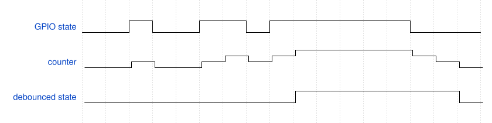

# GPIO Debouncing

## Intro

When pressed, buttons have a tendency to open and close many times in quick succession. This is also known as **switch bounce**.
Embedded projects button inputs must implement a debouncing routine so that a single button press doesn't trigger multiple events.

The GPIO Debouncing public module provides a debouncing routine that is easy to use and adaptable.

Its debouncing routine runs repeatedly at a constant frequency. It reads a GPIO (General-purpose input/output) pin and keeps track of its history using a saturating counter. A saturating counter can be incremented and decremented but is limited to a specific range. When a saturating counter is at its maximum value, incrementing the counter does not change its value. When the GPIO input is high, the saturating counter is incremented. When it is low, the saturating counter is decremented. When the counter reaches its maximum value, the debounced level is set to high. The debounced level is only set to low once the counter reaches zero.

The following image illustrates how the GPIO debouncing module works. When the counter reaches 3, then the debounced state is set to high. Afterwards, the counter reaches 0 and the debounced state is set to low.



This bundle contains multiple example projects with a reusable code module (rs_gpio_debounce.c/h). The following sections will describe how to use this module.

## GPIO Debounce (rs_gpio_debounce)

A GPIO Debounce instance handles debouncing for a single GPIO input. This module depends on FSP's IOPORT module.

In an FSP project, include `rs_gpio_debounce.h` in a C file to be able to use the module.

### Control and Configuration Blocks

The `rs_gpio_debounce` module exposes the `gpio_debounce_ctrl_t` and `gpio_debounce_cfg_t` structures. These two structures when paired together can be treated as a self contained instance. The `gpio_debounce_cfg_t` contains configuration options that control the behavior of this instance.

The `gpio_debounce_cfg_t` is only used when opening the instance, while the `gpio_debounce_ctrl_t` is passed to every function in the `rs_gpio_debounce` module. The `gpio_debounce_ctrl_t` (the control block) encodes whether the instance is open or not and contains instance-specific data that is utilized by the functions in this module. It is highly recommended to not modify the members of the `gpio_debounce_ctrl_t`.

The `gpio_debounce_cfg_t` structure is laid out as follows:

| Member Name | Type |  Use |
|-|-|-|
| portpin           | bsp_io_port_pin_t     | GPIO port and pin number to be debounced. |
| active_level      | bsp_io_level_t        | The GPIO level considered to be "high" by the debouncer. |
| event_enable_mask | gpio_debounce_event_t | A bitmask that controls which events will trigger a callback to be fired. |
| count_to_active   | uint32_t              | How many cycles it takes for the debounced level to be considered "high". |
| count_to_inactive | uint32_t              | How many cycles it takes for the debounced level to be considered "low". |
| p_ioport          | *ioport_ctrl_t        | A pointer to the ioport instance that this debouncing instance will use. |
| p_callback        | function pointer      | A pointer to a callback function that will be called when the debounced state changes. |
| p_context         | void *                | A pointer to a user controlled region of memory that can be used inside a callback. |

### Methods

The following sections describe how to use the functions exposed by the GPIO debounce module.

Each function is structured like an FSP method, returning an FSP error/success value in the form of the `fsp_err_t` type. The parameters and possible errors that can be returned by each function is documented inside of `rs_gpio_debounce.c`.

#### Opening and Closing a GPIO Debounce Instance

The following code opens and closes a GPIO Debounce instance:

```c
fsp_err_t err = rs_gpio_debounce_Open(&g_button0_ctrl, &g_button0_cfg);
if (FSP_SUCCESS != err)
{
  // abort
}
err = rs_gpio_debounce_Close(&g_button0_ctrl);
```

The `rs_gpio_debounce_Open` function will return an error if the instance has already been opened, or if the count_to_active/count_to_inactive parameters are set to 0. The `rs_gpio_debounce_Close` function will return an error if the control structure is closed.

It's also possible to check whether a GPIO Debounce instance is open with the `rs_gpio_debounce_IsOpen` function.

```c
// result is false if g_button0 is closed, and true if it is open
bool result;
rs_gpio_debounce_IsOpen(&g_button0_ctrl, &result);
```

#### Button Update

To debounce a GPIO Debounce instance, call the `rs_gpio_debounce_Update` function at a fixed interval.

```c
rs_gpio_debounce_Open(&g_button0_ctrl, &g_button0_cfg);

while (1)
{
  rs_gpio_debounce_Update(&g_button0_ctrl);
  // delay the loop by 10 milliseconds
  R_BSP_SoftwareDelay(10, BSP_DELAY_UNITS_MILLISECONDS)
}
```

This module's debouncing algorithm internally uses a saturating counter that starts at 0 and caps at `count_to_active`. The update function performs an IOPORT read and increments or decrements the counter depending on the GPIO level.

`gpio_debounce_level_t` is an enum that represents the level of the GPIO debounce instance. It has three fields:

- **GPIO_DEBOUNCE_LEVEL_INVALID**: The GPIO debounce instance is in an invalid state.
- **GPIO_DEBOUNCE_LEVEL_LOW**: The debounced level of the GPIO input is low. This is the default starting value.
- **GPIO_DEBOUNCE_LEVEL_HIGH**: The debounced level of the GPIO input is high.

When the counter reaches its maximum value, the debounced level will be set to `GPIO_DEBOUNCE_LEVEL_HIGH`. The saturating counter's max value will also be set to `count_to_inactive`.

The level will only be set back to `GPIO_DEBOUNCE_LEVEL_LOW` once the counter reaches 0.

In practice, it is recommended to use a timer ISR or an RTOS thread to call the update function. Both options allow other code to run while the delay is happening. Using a timer ISR or RTOS thread instead of `R_BSP_SoftwareDelay` also means that the total time between debounce cycles depends on how long `rs_gpio_debounce_Update` takes to execute.

---
Notes:

- The maximum delay between the button being pressed and the debounced level changing (not factoring in switch bounce) can be calculated by multiplying the "Count To Active/Inactive" setting with the interval at which the update function is called. For example, a button that is polled every 3 milliseconds with a count setting of 5 ticks will change its level after 15 milliseconds in the worst case scenario, assuming that there is no switch bounce. In the best case scenario, this value could be closer to 12 milliseconds, since there is an inherent and variable delay between when the GPIO level changes and when the pin value is actually read.
- There are multiple factors that should be taken into account when setting count values and polling rates. You can find appropriate values by using an oscilloscope to observe how long it takes for a switch to stabilize, or by manually tweaking values in an example project until switch bounce disappears.
- A 20-40 millisecond debouncing delay with a 5ms polling rate is adequate for most usecases, but some embedded devices will need to be highly responsive. For example, a computer mouse designed for competitive video games may choose to call the update function at a 1 millisecond delay (1000hz) and set count_to_active to 1 while setting count_to_inactive 10. This means that when the button is pressed, the debounced state will become high after 0-1 milliseconds, and when the button is released, the debounced state will transition to low in 9-10 milliseconds. The initial press being instantaneous matters in situations that require quick reflexes, but a balanced press-release count value may be better for your use case.

---

#### Debounced State

To get the current logical level of a GPIO Debounce instance, call the `rs_gpio_debounce_GetLevel` function.

```c
rs_gpio_debounce_Open(&g_button0_ctrl, &g_button0_cfg);

// While calling rs_gpio_debounce_Update in a different context:
gpio_debounce_level_t level;
fsp_err_t err = rs_gpio_debounce_GetLevel(&g_button0_ctrl, &state);
if (FSP_SUCCESS != err) {
  // handle error
}

if (state == GPIO_DEBOUNCE_LEVEL_LOW) {
  // Button level is low
}
if (state == GPIO_DEBOUNCE_LEVEL_HIGH) {
  // Button level is high
}

```


#### Callbacks

The GPIO debounce module can be configured to run a callback from the update function when its level changes.
The callback accepts a pointer to a `gpio_debounce_callback_args_t`. This structure is populated with the portpin of the instance, a pointer to a user-defined structure, and a `gpio_debounce_event_t` bitset.

The `gpio_debounce_event_t` enum has these members, each corresponding to a different debouncing event:

- **GPIO_DEBOUNCE_EVENT_RELEASED**: The debounced level has transitioned from high to low.
- **GPIO_DEBOUNCE_EVENT_PRESSED**: The debounced level has transitioned from low to high.

Callback flags control which events will trigger a callback.

The `rs_gpio_debounce_SetCallback` function allows you to set a callback for a GPIO debounce instance:

```c

void button0_callback(gpio_debounce_callback_args_t const * const p_args)
{
  // p_args->portpin has portpin number
  // p_args->event has current event
  if (p_args->event & GPIO_DEBOUNCE_EVENT_RELEASED)
  {
    // Button was released.
  }
  if (p_args->event & GPIO_DEBOUNCE_EVENT_PRESSED)
  {
    // Button was pressed
  }

  example_struct_t * p_example_struct = (example_struct_t *)p_args->p_context;
}

...
// Open GPIO debounce instance
fsp_err_t err = rs_gpio_debounce_Open(&g_button0_ctrl, &g_button0_cfg);

// Set Callback
fsp_err_t err = rs_gpio_debounce_SetCallback(&g_button0_ctrl, button0_callback, &p_context)

// Clear Callback
fsp_err_t err = rs_gpio_debounce_SetCallback(&g_button0_ctrl, NULL, NULL)
```

---
Note:
- Users should try to keep the callback function short, especially if the GPIO debounce instance is being updated from an ISR.
- To avoid undefined behavior, the p_context parameter should point to a global variable.

---

## Example Projects

This package contains two example projects targeting the FPB-RA2E3, each demonstrating a different way to debounce a button without a software delay. When running the example projects on the FPB-RA2E3, pressing SW1 will turn LED1 on, and releasing SW1 will turn the onboard LED off. One project is a baremetal project (called debounce_[boardname]) and depends on FSP's AGT module to call the debouncing routine. The other project (called debounce_freertos_[boardname]) doesn't depend on an FSP timer but depends on FreeRTOS. Both projects depend on the IOPORT module in FSP to read the state of a GPIO port.

The example projects come with multiple different source files:

- GPIO Debouncing Layer
  - `rs_gpio_debounce.c/h`
    - Contains public functions that implement debouncing logic. This code is designed to be used within any FSP project.
- Configuration Layer
  - `debounce_[freertos_]config.c/h`
    - Contains reference configurations for each example project. These are different between FreeRTOS and baremetal, and they are unique to each supported board.
  - `rs_gpio_debounce_cfg_gen.c/h`
    - Provides an optional mechanism for populating and checking a `gpio_debounce_cfg_t` at runtime. These files depend on the reference configurations but are shared between all example projects.
- Demo Layer
  - `rs_gpio_debounce_demo[_freertos].c/h`
    - This contains the main functionality of the application project and is different between FreeRTOS and baremetal and shared between boards.

Both projects target FSP 6.5.0 and require a Renesas FPB-RA2E3 evaluation kit and a micro-USB cable in order to run. The example projects are located in the [examples](../examples) directory. There are two copies of these example projects, one targeting e2 studio and the other targeting Visual Studio Code with the Renesas VS Code Extensions. For more information about how to build FSP projects in VS Code, read the [Renesas VS Code Extensions documentation](https://tool-support.renesas.com/e2studio/vscode/docs/index.html). Resources about e2 studio can be found [here](https://www.renesas.com/en/software-tool/e2-studio) as well.

### Config Generation

When evaluating a project it may be helpful to change different parameters without having to recompile your program. Additionally, it can be helpful to use a pre-set configuration when evaluating a project and validate that it is proper during runtime.

The configuration generation functions present in the `rs_gpio_debounce_cfg_gen` files perform this function.

Calling the `fsp_err_t rs_gpio_debounce_GenConfig (gpio_debounce_cfg_t * const p_cfg, uint32_t const config_size)` function will copy a reference configuration (stored in flash and can be found in `debounce_config_*.c/h`). This function also takes in a `config_size` parameter for validation checking. This structure can then be used in the entrypoint of the example project.

The `fsp_err_t rs_gpio_debounce_CheckConfig (gpio_debounce_cfg_t const * const p_cfg)` function makes sure that the provided `p_cfg` matches the reference configuration.

The `fsp_err_t rs_gpio_debounce_GetConfigSize (uint32_t * p_size)` function stores the size of the configuration struct into `p_size`.

### Baremetal Example Project

The `debounce_*` project does not use an RTOS. Instead, it utilizes an Asynchronous General-purpose Timer (AGT) with interrupts. Using a timer avoids software delays which block program execution on single-core MCUs. The configurations were changed from the default AGT settings as follows:

- General
  - Period: 10
  - Period Unit: Milliseconds
- Interrupts
  - Callback: timer_isr
  - Underflow Interrupt Priority: 3 (can be set to anything in this example)

The period has been set to 10ms. For usecases where latency is important, this should be set to 1-5 milliseconds. The interrupt settings also ensure that when the timer is enabled, the interrupt handler by the name of "timer_isr" will be called.

The reference configuration is defined in `debounce_*_config_*.c`. It has the following options set:

```c
gpio_debounce_cfg_t g_gpio_debounce_cfg_ref = {
    .active_level = BSP_IO_LEVEL_LOW, // P200 has an internal pull-up, so this should be set to low.
    .count_to_active = 5,             // 5 cycles * 10ms = 50ms.
    .count_to_inactive = 5,           // 5 cycles * 10ms = 50ms.
    .event_enable_mask = GPIO_DEBOUNCE_EVENT_PRESSED | GPIO_DEBOUNCE_EVENT_RELEASED,
    .p_ioport = &g_ioport,
    .portpin = [depends on evaluation kit],
    .p_callback = &button_cb
};
```

#### Entry Point Code

The `hal_entry.c` file calls the `start_debounce()` function located in `rs_gpio_debounce_demo.c` file. This function is defined as follows with added comments for clarification:

```c
void start_debounce (void) {
    const timer_instance_t * p_timer_instance;

  // Generate a config (stored in &g_gpio_debounce_cfg) and check the config.
  // Set the timer to either the preset timer in debounce_config_*.c or a user-defined timer instance.
#if DEBOUNCE_PRESET_CONFIG_USE
    extern const timer_instance_t g_timer0_preset;
    p_timer_instance = &g_timer0_preset;
    APP_ERR_TRAP(rs_gpio_debounce_GenConfig(&g_gpio_debounce_cfg, sizeof(gpio_debounce_cfg_t)));
    APP_ERR_TRAP(rs_gpio_debounce_CheckConfig(&g_gpio_debounce_cfg));
#else
    p_timer_instance = &g_timer0;
#endif

    // Open the button instance.
    APP_ERR_TRAP(rs_gpio_debounce_Open(&g_gpio_debounce_ctrl, &g_gpio_debounce_cfg));

    // Open and start the AGT instance.
    R_AGT_Open(p_timer_instance->p_ctrl, p_timer_instance->p_cfg);
    R_AGT_Start(p_timer_instance->p_ctrl);
}
```

The timer instance has been configured to fire interrupts whenever it underflows every 10 milliseconds.
After the `R_AGT_Start` function has been called, the `timer_isr` function will be called. The `timer_isr` function calls `rs_gpio_debounce_Update()`.

The preset configuration for the GPIO debounce instance has its callback function set to `button_cb()`. That function is defined as follows:

```c
void button_cb (const gpio_debounce_callback_args_t * p_args) {
    if (p_args->event == GPIO_DEBOUNCE_EVENT_PRESSED)
    {
        R_IOPORT_PinWrite(&g_ioport_ctrl, LED1, BSP_IO_LEVEL_HIGH);
    }
    else if (p_args->event == GPIO_DEBOUNCE_EVENT_RELEASED)
    {
        R_IOPORT_PinWrite(&g_ioport_ctrl, LED1, BSP_IO_LEVEL_LOW);
    }
}
```

This function will be called when the debounced state changes. This function checks whether the event field of the callback args corresponds to a press or release of SW1 and performs an IOPORT write to the LED1 pin accordingly.


### FreeRTOS Example Project

The `debounce_freertos_*` project uses a realtime operating system called FreeRTOS to allow for multiple tasks to run independently of each other. FreeRTOS' scheduler switches between tasks to create the appearance that all the tasks are running at the same time.

When creating an RTOS project, it can be helpful to dedicate a task to input handling and have it run in a loop with a delay. During the delay period, other tasks will be able to run.

#### Configuration

The reference configuration for the GPIO debounce instance is unchanged. This project does not include a timer configuration.

This project is configured to have a thread with the following configuration:

- Thread
  - Symbol: debounce_thread
  - Name: Debounce Thread

#### Execution

The `debounce_thread_entry` function in `debounce_thread_entry.c` immediately calls the `start_debounce` function contained in `rs_gpio_debounce_demo_freertos.c`.

The start_debounce function does the same configuration generation steps as the baremetal project. From that point on, the function is defined as follows:

```c

void start_debounce (void) {

...
    APP_ERR_TRAP(rs_gpio_debounce_Open(&g_gpio_debounce_ctrl, &g_gpio_debounce_cfg));

    TickType_t xLastWakeTime = xTaskGetTickCount();

    while (1)
    {
        vTaskDelayUntil(&xLastWakeTime, (10 / portTICK_PERIOD_MS));
        rs_gpio_debounce_Update(&g_gpio_debounce_ctrl);
    }
}
```

This function calls `rs_gpio_debounce_Update` in a loop with a delay of 10 milliseconds, just like the baremetal project. It does this by using the `vTaskDelayUntil` function present in FreeRTOS. The `vTaskDelayUntil` function takes two parameters: a pointer to the time the current task was last unblocked, and a time increment in ticks. When this function is called, the `xLastWaitTime` variable will be updated to the current tick count and the task will be suspended until `xLastWakeTime` plus the specified tick increment. This means that the time it takes for rs_gpio_debounce_Update to execute does not impact how long the delay will be, since the delay is relative to when the task left the blocked state.

There are some caveats to this method, however:
- It is important to take measures so that other tasks do not block the button debouncing task. This can be done by setting the priority of the debouncing task to be higher or using critical sections. If that isn't acceptable for your use case, using a timer ISR may work better for you.
- If the debounce loop needs to have a delay that is shorter than the FreeRTOS tick rate, then a timer ISR is necessary.
